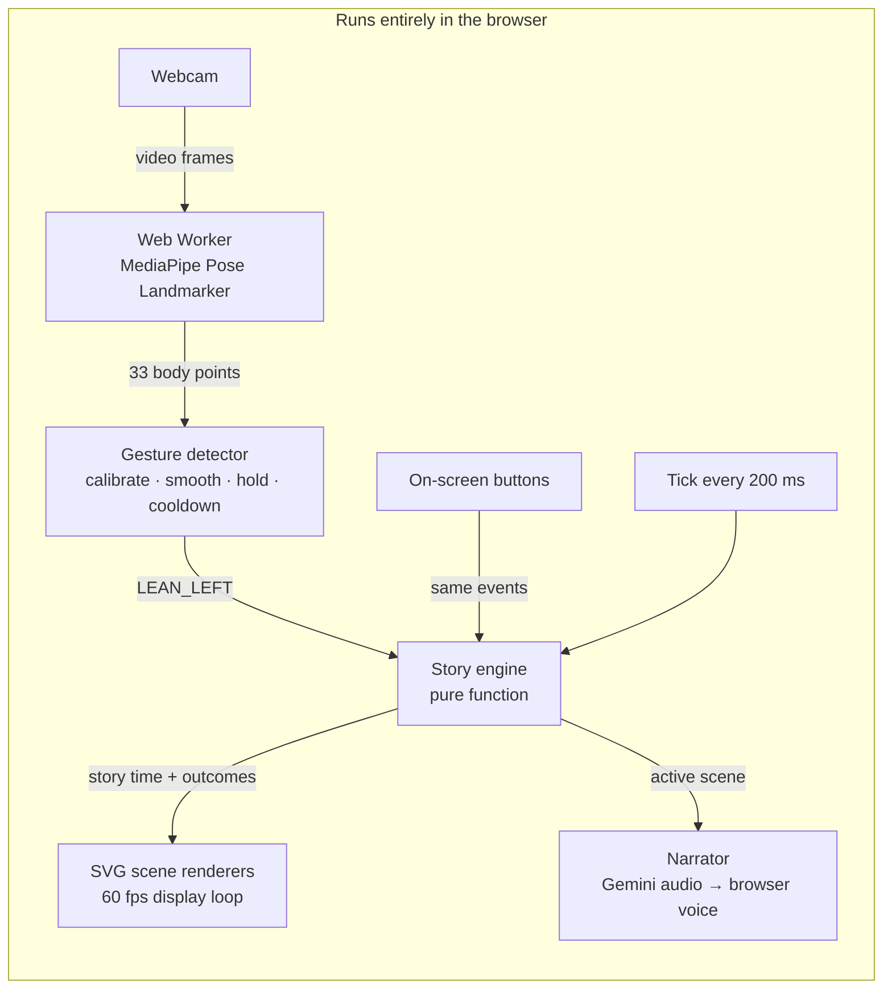

# StoryMotion

**Step into the story.** An animated picture book that kids ages 5–10 help tell with their whole body.

Built at **HackTX 2026** · React · TypeScript · MediaPipe · Web Workers · SVG animation · Gemini TTS

> **Devpost:** https://devpost.com/software/storymotion

---

## The idea

Most stories ask kids to sit still and watch. StoryMotion turns them into helpers.

A story plays like a short cartoon, with narration and captions. At key moments it pauses and asks the child for help: *spread your arms to raise a magic shield*, *lean to choose a path*, *raise your hand to make the beanstalk grow*. The laptop webcam spots the movement and the scene reacts right away.

There's no score and no way to fail. If nobody moves, the story gently carries on. Every movement also has a big on-screen button, so kids can play seated, without a camera, or with a grown-up's help.

## Features

- 📖 **Three complete animated stories.** Each has its own world, characters, moral and reward badge.
- 🙌 **Five body gestures**, recognized live from the webcam: raise a hand, lean left, lean right, arms wide, crouch.
- ✨ **Instant reactions.** Shields, sparkles, path choices, boosts and confetti appear the moment a gesture lands.
- 🎙️ **Narrated scenes.** Voices were generated ahead of time with Gemini TTS, the browser's built-in voice fills in automatically, and captions are always on.
- 👨‍👩‍👧 **Family Adventure mode.** It ends with a reflection prompt for the parent and child to talk about together.
- ♿ **Accessible by default.** Every gesture has a button alternative, gestures work seated (only crouch needs your legs in view), reduced-motion settings are respected, and pause, restart, mute and replay are always there.
- 🔒 **Private by design.** The camera is processed on the device. Nothing is recorded, uploaded or stored, and there are no accounts.
- 🎨 **Art drawn entirely in code.** Every character and background is original SVG, with no stock images or sprite sheets.

## The stories

| Story | Hero | How the child helps | Moral |
|---|---|---|---|
| **The Tortoise and the Hare** | Tortoise or Hare | 🫸 Arms wide for a leaf shield · ↔️ lean to pick a trail · ✋ raise a hand for a final boost | *Slow and steady, with heart, wins the day.* |
| **Jack and the Beanstalk** | Jack | ✋ Raise a hand to grow the beanstalk · ↔️ lean to dodge · 🫸 arms wide | *Be brave, think before you choose, and share what you have.* |
| **The Three Little Pigs** | The Three Little Pigs | ✋ Raise a hand to place the last brick · 🫸 arms wide to protect and brace the house | *Hard work and careful planning keep everyone safe.* |

## How it works



**One file for every story's plot.** Each story is an ordered list of scenes in `src/data/stories/scenes.ts`, holding the caption, the characters on screen, the length and any interaction moments. Narration, captions, animation and gesture moments all read the same scene, so what's said always matches what's shown.

**A story engine written as one pure function.** `src/engine/automaticStory.ts` takes the current state and an event (`TICK`, `PAUSE`, `NARRATION_FINISHED`, a gesture…) and returns the new state. Story time stops at each moment until that scene's narration ends. The invitation then stays open for a few seconds and resolves itself if nobody answers. Camera gestures and buttons send identical events, so both paths behave the same. The engine can be tested without a browser, camera or model.

**Animation calculated from story time.** Every scene works out where everything is from story time, so pause, restart and tests stay in sync for free. A display loop running at the screen's refresh rate smooths the 200 ms engine ticks to 60 fps and writes positions directly onto the page, so React isn't re-rendering every frame. There are three renderers:
- **Forest race:** a 5400 px wide world shown through a moving camera, with layered depth and a canvas particle system we wrote (no library).
- **Beanstalk climb:** a tall world the camera scrolls upward through.
- **Storybook scenes:** small scene definitions with their own camera moves and sound cues.

**Pose tracking off the main page.** MediaPipe Pose Landmarker (lite) runs in a module **Web Worker** with one frame processed at a time, so detection never stutters the animation. The gesture detector (`src/vision/bodyGestures.ts`):
- measures movement relative to the child's shoulder width, so any size and distance works;
- learns the child's standing position first;
- needs a short steady hold before counting a gesture;
- checks which joints are visible;
- waits for a return to neutral and applies a cooldown, so each movement counts exactly once.

**Narration with layered fallbacks.** `scripts/generate-narration.mjs` voices each caption with Gemini TTS *ahead of time*, so the app makes no AI calls while playing. A recording only plays if it was made from the exact current caption. If it's missing, out of date or fails, the browser's built-in voice takes over, and if nothing finishes in time the story still moves on.

**Sound effects generated in code.** All sound effects are made with Web Audio, so there are no audio files and no licensing questions.

## Tech stack

| Layer | Technology |
|---|---|
| App | React 19, TypeScript, Vite 8, React Router 7 |
| Pose detection | `@mediapipe/tasks-vision` Pose Landmarker (lite, float16) in a Web Worker |
| Animation | Hand-written SVG, CSS animations, a `requestAnimationFrame` display loop, our own canvas particle system |
| Narration | Gemini TTS (generated ahead of time) + Web Speech API as fallback |
| Sound effects | Web Audio API, generated in code |
| Testing | Vitest, React Testing Library, jsdom, and a Chrome DevTools Protocol smoke test |
| Hosting | Vercel (static site) |

## Privacy

StoryMotion is for children, so privacy is part of the design:

- Video frames go straight to a Web Worker in the browser, are analyzed, and are thrown away. **Nothing is recorded, saved or uploaded.**
- Only gesture names (like `ARMS_WIDE`) leave the worker. No images or body data do.
- There are no accounts, names, analytics or personal data. Session state lives in memory and clears on reload.
- The camera is optional, and the whole story is playable without it.

## Getting started

Requires **Node 20.19+ or 22.12+** (developed on Node 24) and a recent **Chrome** or Edge. The camera needs `localhost` or HTTPS.

```sh
git clone https://github.com/Shubham-input/storymotion.git
cd storymotion
npm install
npm run dev
```

Open the printed `localhost` URL, then:

1. **Start Adventure** → choose **Solo** or **Family**.
2. Pick a story and a hero → **Let's Go**.
3. Allow the camera (optional) and stand or sit 2–3 m back so your upper body is in view. Relax your arms for a second while it calibrates.
4. When an invitation appears, do the movement or tap its button.

**Tips:**
- Add `?debugPose=1` to the player URL to see the pose skeleton overlay.
- The ⤢ button opens full-screen cinema mode.

### Regenerating narration (optional)

The recordings in `public/audio/narration/` are already committed, so you only need this if you change captions.

```sh
cp .env.example .env.local      # then set GEMINI_API_KEY in .env.local
npm run generate:narration:dry  # preview which lines would be generated
npm run generate:narration
```

The key is read only by this local script and is never sent to the browser. See [`docs/GEMINI_NARRATION.md`](docs/GEMINI_NARRATION.md).

## Scripts

| Command | What it does |
|---|---|
| `npm run dev` | Start the dev server |
| `npm run build` | Typecheck and make a production build in `dist/` |
| `npm run preview` | Serve the production build |
| `npm test` | Run the Vitest suite |
| `npm run lint` | Run ESLint |
| `npm run typecheck` | Run the TypeScript compiler without emitting files |
| `node scripts/browser-smoke.mjs <url>` | Drive headless Chrome and run the real pose model on a test image |

## Project structure

```text
src/
├─ app/          routes and in-memory session (mode, hero, audio settings)
├─ components/   Home, Library, Character Select, Camera, Player, Completion
├─ data/stories/ scenes.ts (the plot of every story), story registry, narration list
├─ engine/       automaticStory.ts: pure story reducer
├─ rendering/    forest/, beanstalk/, storybook/: SVG scene renderers
├─ vision/       camera controller, pose worker, gesture detector
├─ audio/        narrator (Gemini audio → browser voice), Web Audio sound effects
├─ hooks/        useNarration, useUiSounds
└─ tests/        21 test files
public/
├─ models/       pose_landmarker_lite.task, hosted in the app for slow venue Wi-Fi
└─ audio/        recorded narration
scripts/         generate-narration.mjs, browser-smoke.mjs
```

## Testing

```sh
npm run typecheck && npm run lint && npm test && npm run build
```

As of the last run on this branch, **162 tests in 21 files pass**, and typecheck, lint and build are clean. The suite covers:

- the story engine (ticks, moments, pause, restart, camera setup holds);
- the gesture detector on made-up pose sequences (idle, partial motion, holds, re-triggering, tracking loss);
- story completeness: every scene in order, with captions in sync, through to the ending with no input;
- narration fallbacks;
- the player and camera UI.

The automated tests don't use a physical webcam. Gesture accuracy with real people is checked by hand, and the notes are in [`docs/GESTURE_QA.md`](docs/GESTURE_QA.md).

## Challenges we ran into

- **MediaPipe in a module worker** failed with `ModuleFactory not set`. The package's ES-module WASM loader (`forVisionTasks(root, true)`) fixed it without moving inference back onto the main page.
- **The camera worked once, then broke.** Vite re-bundled MediaPipe in the middle of a session and the worker's import returned a 504. Pre-bundling it (`optimizeDeps.include`) fixed it.
- **Slow venue Wi-Fi** stalled the model download past our 30-second safety limit, so the app now serves the model itself, with Google's official copy as a backup.
- **Counting each gesture once** is harder than detecting it. Measuring relative to the body, requiring a steady hold, waiting for a return to neutral, and never treating lost tracking as neutral made it reliable.
- **Smooth animation without a 60 fps React re-render.** Separating story time from display time and interpolating in a display loop solved it.

## What's next

- More stories, plus a simple way for parents and teachers to write their own.
- More movements (jump, march, balance), tuned through testing with real families.
- A fuller Family Mode, where the parent makes story choices and the child does the movements.
- Recorded narration for every story (Three Pigs still uses the browser voice).
- Better support for tablets and classrooms.

---

<sub>StoryMotion is designed to encourage movement and shared storytelling. It isn't a fitness or health product. Story classics are retold in age-appropriate versions, and all art and sound effects are original.</sub>
